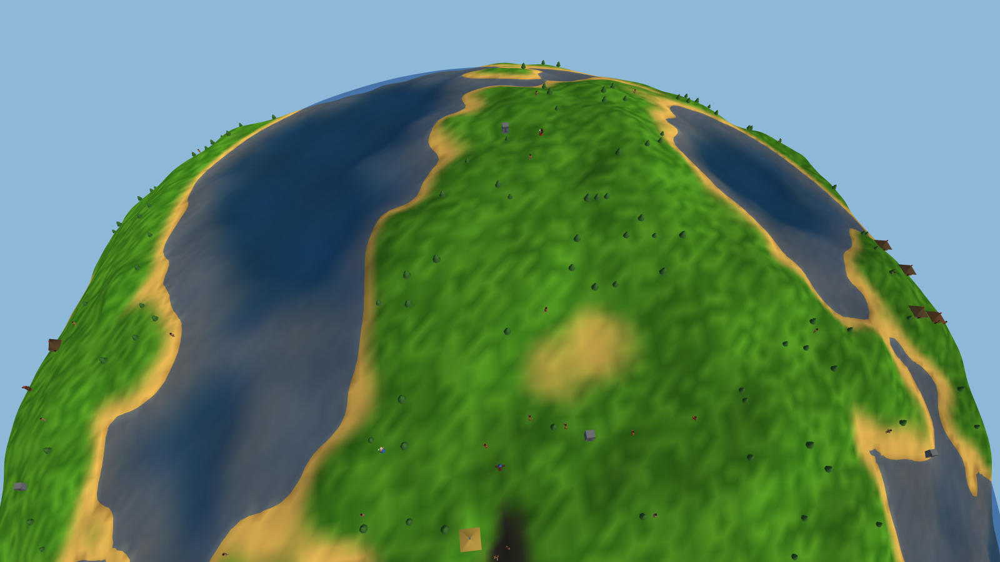

# Tribal Gods

An original god game for the browser, in a classic genre: a small round
world, a tribe that grows, and a leader who speaks with the sky. You raise
dwellings, train fighters, learn spells at standing stones and reshape the
planet itself — raise land bridges, sink coastlines, start volcanoes — to
outlast up to three rival gods. Built from scratch in TypeScript and
three.js: no game engine; terrain, characters, animation, camera,
simulation and sound are all hand-built and heavily commented. The design
lives in [SPEC.md](SPEC.md) (section 11 is the current one) and the
content contract in [`src/sim/catalog.ts`](src/sim/catalog.ts).



> **▶ [Play it in your browser](https://br3nt.github.io/tribal-gods/)**

This whole project — design, code, art, sound, and the in-browser play-testing —
was built collaboratively with **Claude Fable 5** over a series of conversations.
It's an experiment in how far a model can carry a real-time 3D game from a blank
folder to a finished, shareable thing. Write-up:
[br3nt's blog](https://br3nt.github.io/).

*Tribal Gods belongs to the genre of the late-1990s god games and is not a
clone of any of them: its roster, spell book, scenarios, art, sound and
interface are original, and every asset is procedurally generated. Names of
other games mentioned anywhere in this repository are trademarks of their
owners; this project is not affiliated with or endorsed by any of them.*

## Run it

```sh
npm install
npm run dev        # then open the printed localhost URL
npm run build      # type-check + production bundle
npm test           # the Vitest suite (headless sim, ~40 s)
```

## How it plays

**Your people.** Villagers chop wood, raise buildings, fill dwellings and
breed. A dwelling that stays full grows — twice — into a bigger home with
more beds. Your **leader** is the only one who casts; if she falls she
returns at the home circle after a while, as long as the tribe lives.

**The charge model.** There is no mana pool to spend. Mana trickles in from
your people (more from those housed, more again while villagers pray at a
Shrine) and is poured evenly into every spell you know that is switched on
to charge. Each spell fills a charge when it has soaked up its cost, up to
its maximum; casting spends one charge. Small spells come back in seconds,
world-shapers are a plan you make minutes ahead — and switching spells off
(right-click a slot) to feed one faster is a real decision. Standing stones
either **teach** a spell for good (first leader to commune wins it) or
**gift** a few free casts and then sleep.

**Units** (trained from villagers, one building each):

| Unit | Trained at | Role |
|---|---|---|
| Villager | — (born in dwellings) | Chops, hauls, builds, breeds, prays |
| Warrior | War Lodge | Melee; wins any fight it can reach |
| Emberthrower | Ember Lodge | Ranged, sets buildings alight, fragile |
| Warden | Warden Hall | Slow, nearly unkillable, wrecks buildings, halves spell damage |
| Chanter | Chant Hall | Unarmed; enemies who hear the chant stop fighting, then defect |
| Leader | — | Casts every spell; communes at standing stones |

**Buildings:** Dwelling, Lumberyard (second wood drop, faster chopping,
replanting), Watchtower (garrison two fighters: more reach and damage),
War Lodge, Ember Lodge, Shrine (villagers pray: every charging spell
speeds up), Chant Hall, Warden Hall. Each shows its prerequisites in the
build menu.

**Spells** (three tiers, on three keyboard rows):

| Tier | Spells |
|---|---|
| I — everyday | Blast, Kindle (convert wanderers), Level, Bloom, Stone Ward |
| II — decide a battle | Lightning, Warsong, Mire, Causeway, Cyclone |
| III — reshape the planet | Emberfall, Undertow, Quake, Volcano |

**Rival gods** play by the same rules (same wood, same queues, same charge
model, same stones). They grow a town, raid, assault, and defend; their
leaders cast with restraint (a pause between spells by difficulty, and only
at a target worth the charge); and if you live across the sea they learn
Causeway and bridge the narrowest strait to reach you.

## Controls

From the game's own hotkey table ([`src/ui/hotkeys.ts`](src/ui/hotkeys.ts);
F1 in game shows the same list).

| Input | Action |
|---|---|
| W A S D / arrows · Q E · wheel | Pan · rotate · zoom toward the cursor |
| Click · drag · double-click | Select · box-select your people · all of that kind on screen |
| Shift + click | Add to / remove from the selection |
| Right-click | Context order: move, attack, garrison, commune, rally |
| R T Y U I | Tier I spells: Blast, Kindle, Level, Bloom, Stone Ward |
| F G H J K | Tier II: Lightning, Warsong, Mire, Causeway, Cyclone |
| V B N M | Tier III: Emberfall, Undertow, Quake, Volcano |
| Shift + 1–8 | Build: Dwelling, Lumberyard, Watchtower, War Lodge, Ember Lodge, Shrine, Chant Hall, Warden Hall |
| 1–9 · Ctrl + 1–9 | Recall a control group (twice: jump to it) · make one |
| , (comma) · . (period) · L | Select every fighter · next idle villager · select your leader |
| Space · C | Jump to your leader · jump to your home circle |
| P · [ · ] | Pause · slower · faster |
| Delete / Backspace | Demolish the selected building (press twice) |
| Esc | Cancel aiming/placing; else the menu (which pauses) |
| F1 · F3 | How to play · debug readout (then - / = sculpt, Shift + [ ] brush size) |

A spell or building armed with Shift + click stays armed for another.
Right-click a spell slot to switch its charging on or off. The minimap
jumps the camera (click or drag) and takes right-click orders.

## Campaign

*The Long Tide*: ten hand-made chapters — Landfall, The Speaking Stones,
Smoke Over the Ridge, The Scattered Shallows, Vigil at the Caldera, The
Barefoot Road, Two Banners, The Firemount Race, When the Tide Came, The
Crown. Each has a briefing, required and optional objectives, fail
conditions, scripted events (raids, betrayals, the sea rising) and a
narrator line at the top of the screen. Winning a chapter offers a **boon**
that carries forward (an extra Blast charge, three more villagers, a
standing Dwelling…). Progress, best times and stars are kept in your
browser.

**Save & Continue.** A game in progress is saved when you open the menu,
leave, or hide the tab, and once a minute; **Continue** on the title
screen picks it up exactly where it was (campaign chapters included).

## Levels, the editor and sharing

The title screen also opens **Skirmish** (a random planet against one to
three rivals, three difficulties), **Levels** (the library: three official
levels, the campaign chapters, and every level you save or import) and the
**Editor**.

**The editor** is the game world with the simulation frozen: sculpt with
raise / lower / flatten brushes (`[` `]` size them), plant trees, place
wanderers, put down standing stones (any of the fourteen spells, teaching
or gifting), and move up to four tribes' home circles — placing a new
tribe's home adds it as an AI rival; erasing a rival's home removes it.
*Test* plays the level instantly and *Back to the editor* returns with the
terrain pristine. *Save* files it in your library. The editor does not edit
scenario rules (loadouts, objectives, scripted events); a level made there
plays as "destroy every rival", and campaign chapters keep their own rules.

**Sharing** is by code: *Copy code* puts a `TG2.…` string on your
clipboard — the whole planet, delta-encoded, deflated and base64'd into a
few KB of text — and *Import code* in the library turns one back into a
playable level (older `TG1.` codes still load). The storage layer
(`src/level/store.ts`) is shaped so an online level server could replace
localStorage without the UI noticing.

## Settings

Sound (master volume and mute), graphics quality (Auto / Low / Medium /
High — applied live; only the terrain mesh's detail waits for the next
load), interface size, edge panning and hints. All sound is synthesised
live with the Web Audio API — effects for every world event, attenuated by
distance from the camera, plus a quiet ambient bed of wind, surf and birds
(`src/core/audio.ts`, `src/core/sfx.ts`).

## Development

- `npm test` runs the Vitest suite: the simulation is headless (no
  three.js, no DOM) and deterministic, so sim behaviour is tested
  directly — spells, the charge model, AI judgement and bridging, regions,
  save/restore determinism, campaign maps and bot play-throughs.
- `BALANCE=1 npx vitest run test/balance.test.ts` plays chapters 1–5 and a
  Normal skirmish with a scripted, human-paced player and prints a timeline
  (population, dwelling tiers, army, mana, first lodge, first contact).
- `node tools/shot.mjs "<url>" out.png [--wait ms] [--eval js]` takes a
  headless screenshot of a running dev server (`npx vite --port 52xx
  --strictPort`); `?play=1&seed=N` skips the menu, `?play=1&scenario=<id>`
  jumps into a campaign chapter, and `window.__tg` is the automation handle.
- `node tools/playthrough.mjs "<base url>" [--shots dir]` drives the game
  through real mouse and keyboard input — selection, orders, all eight
  buildings, all four trainable units, garrisons, demolish, speed, control
  groups, the minimap, all fourteen spells, save/continue and the campaign
  flow — and prints a pass/fail checklist.
- `?gallery=1` opens the art review booth (every model and animation).

## Where the code lessons are

Every module opens with a prose header explaining the technique it
implements. Suggested reading order is in `src/main.ts`; start with
`src/world/heightmap.ts` and `src/world/curvature.ts` for the planet
illusion (the world is a wrapping grid; the horizon is a rendering trick),
then `src/sim/world-state.ts` and `src/sim/pathfinding.ts` — pathfinding
runs on the same grid as the terrain, so raise a causeway and the route
exists the moment the land does.
